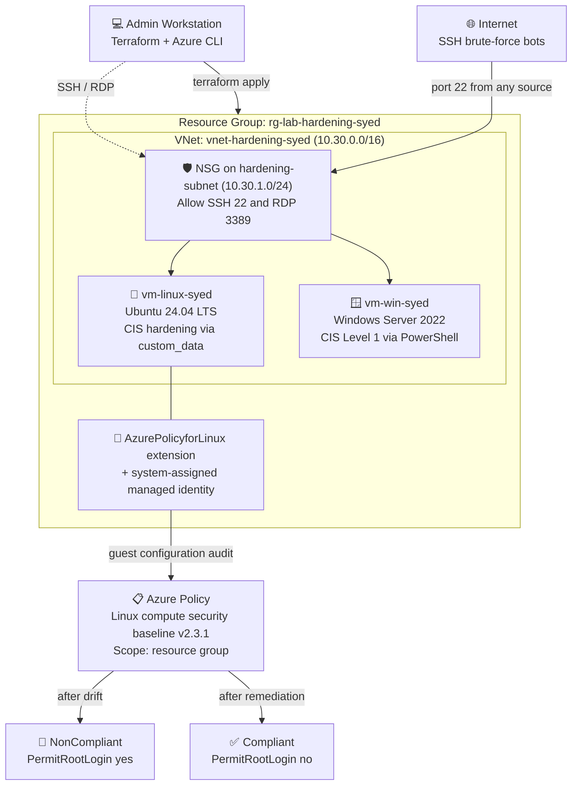
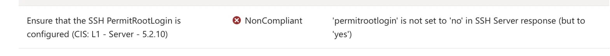
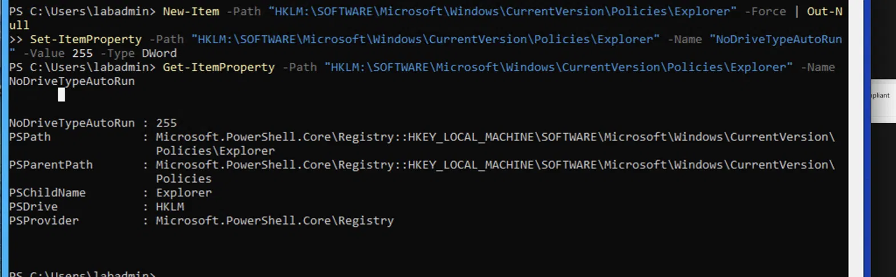
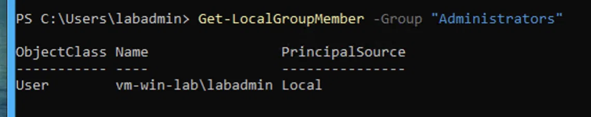
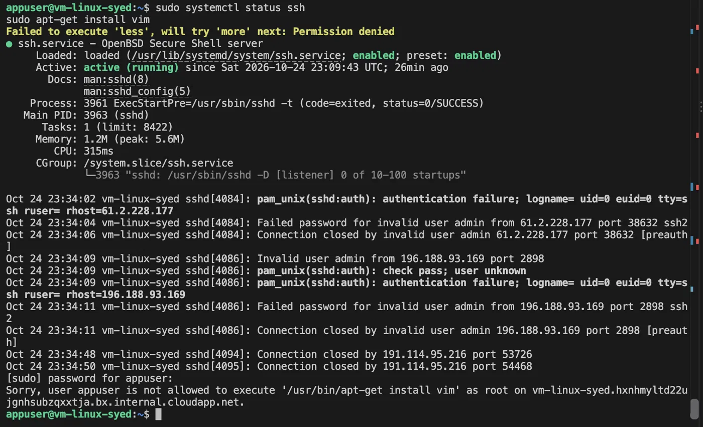

# Hardening Linux and Windows Servers in Azure with CIS Baselines and Azure Policy

## 🎬 Watch Me Build This Lab!

**[▶️ Watch the walkthrough on Loom](https://loom.com/share/9f78a8765dcb48ba85eff797bf80b776)**

## 📖 Project Overview

This project deploys an Ubuntu 24.04 VM and a Windows Server 2022 VM to Azure with Terraform, hardens both to a CIS Level 1 baseline, and uses **Azure Policy Guest Configuration** to continuously audit the Linux VM from inside the OS. I deliberately misconfigured SSH to simulate configuration drift, watched Azure Policy flag it as NonCompliant, remediated it, and confirmed it returned to Compliant. I finished by creating least-privilege service accounts on both systems and proving the restrictions hold.

**Skills demonstrated:**

- **Infrastructure as Code:** Terraform deployment of the network, NSG, both VMs, and the Guest Configuration extension
- **Linux hardening:** SSH lockdown, PAM password complexity and lockout, auditd, UFW, disabled filesystems and services
- **Windows hardening:** CIS Level 1 account lockout, password policy, Guest account, firewall, audit policy and autoplay via PowerShell
- **Compliance monitoring:** Azure Policy Guest Configuration and drift detection against the Azure compute security baseline
- **Least privilege:** Scoped sudoers rules with `NOEXEC` on Linux and a non-admin local account on Windows
- **Troubleshooting:** 20 real deployment and configuration issues worked through and documented below

## 🏗️ Architecture Diagram



**How it works:** Terraform builds a single VNet with one subnet protected by an NSG. The Linux VM hardens itself on first boot through a `custom_data` script, and the Windows VM is hardened over RDP with PowerShell. On the Linux VM, a system-assigned managed identity and the AzurePolicyforLinux extension let Azure Policy audit settings inside the OS, such as `sshd_config`, and report each CIS control as Compliant or NonCompliant.

## ✅ Prerequisites

- [ ] An active Azure subscription
- [ ] Terraform installed and the Azure CLI authenticated (`az account show`)
- [ ] An SSH client and an RDP client
- [ ] A region with capacity for `Standard_D2ds_v4` (check with `az vm list-skus`)
- [ ] ⏱️ Up to 30 minutes for Guest Configuration to report results after the policy is assigned

## 🏷️ Naming Conventions Used

| Resource | Value |
|----------|-------|
| Resource group | `rg-lab-hardening-syed` |
| Virtual network | `vnet-hardening-syed` (`10.30.0.0/16`) |
| Subnet | `hardening-subnet` (`10.30.1.0/24`) |
| Network security group | `nsg-hardening-syed` |
| Linux VM | `vm-linux-syed` |
| Windows VM | `vm-win-syed` (computer name `vm-win-lab`) |
| Public IPs | `pip-linux-syed`, `pip-win-syed` |
| NICs | `nic-linux-syed`, `nic-win-syed` |
| VM size | `Standard_D2ds_v4` |
| Guest Configuration extension | `AzurePolicyforLinux` |
| Least-privilege account | `appuser` |

> Every name is built from `var.yourname`, so anyone can deploy their own copy by changing one value in `terraform.tfvars`.

## 🪜 Project Steps

### Step 1: Deploy the Infrastructure with Terraform · [0:10](https://loom.com/share/9f78a8765dcb48ba85eff797bf80b776?t=10)

1. Copy `terraform.tfvars.example` to `terraform.tfvars` and fill in your own values. `.gitignore` keeps this file out of Git.
2. Run:
   ```bash
   terraform init
   terraform plan
   terraform apply
   ```
3. Note the `linux_public_ip` and `windows_public_ip` outputs.

✅ **Result:** Both VMs are running, and the NSG is associated to the subnet so its rules apply to both.

### Step 2: Verify the Linux Hardening · [1:33](https://loom.com/share/9f78a8765dcb48ba85eff797bf80b776?t=93)

On first boot, the `custom_data` script disables cramfs and freevxfs, disables avahi-daemon and cups, installs auditd, sets `PermitRootLogin no`, enforces 14-character complex passwords through `pwquality`, locks accounts after 5 failed attempts with `pam_faillock`, and enables UFW.

1. SSH in with `ssh labadmin@<linux_public_ip>`.
2. Verify each control:
   ```bash
   systemctl status auditd                     # active (running)
   grep PermitRootLogin /etc/ssh/sshd_config   # PermitRootLogin no
   sudo ufw status                             # Status: active, 22/tcp allowed
   sudo modprobe cramfs 2>&1                   # could not insert 'cramfs'
   cat /var/log/hardening.log                  # Hardening complete
   grep minlen /etc/security/pwquality.conf    # minlen=14
   ```

✅ **Result:** Every check returns the expected hardened value.

### Step 3: Enable Guest Configuration and Assign the Baseline Policy · [3:04](https://loom.com/share/9f78a8765dcb48ba85eff797bf80b776?t=184)

1. Guest Configuration needs two things on the VM, both defined in `main.tf`. The lab guide didn't mention either one.
   - A **system-assigned managed identity** (`identity { type = "SystemAssigned" }`)
   - The **AzurePolicyforLinux** extension (`Microsoft.GuestConfiguration` / `ConfigurationForLinux`)
2. In the portal, go to **Policy → Definitions** and search **"security baseline"**. The guide's search term, "Linux security baseline", returns nothing.
3. Assign **"Linux machines should meet requirements for the Azure compute security baseline"** (v2.3.1) to `rg-lab-hardening-syed`.

> On Ubuntu 24.04, SSH runs through `ssh.socket`, so the policy skipped every SSH rule until I switched to `ssh.service` (see Troubleshooting #14).

### Step 4: Break an SSH Control to Simulate Drift · [2:24](https://loom.com/share/9f78a8765dcb48ba85eff797bf80b776?t=144)

1. Re-enable root login on the Linux VM:
   ```bash
   sudo sed -i 's/PermitRootLogin no/PermitRootLogin yes/' /etc/ssh/sshd_config
   sudo systemctl restart ssh
   grep PermitRootLogin /etc/ssh/sshd_config   # PermitRootLogin yes
   ```
2. Trigger a rescan, or wait for the next Guest Configuration evaluation.

✅ **Result:** CIS 5.2.10 "Ensure that the SSH PermitRootLogin is configured" reports **NonCompliant** with `permitrootlogin` set to `yes`. The drift was detected.



### Step 5: Remediate and Confirm Compliance

1. Restore the control and tighten the config file's permissions:
   ```bash
   sudo sed -i 's/^PermitRootLogin.*/PermitRootLogin no/' /etc/ssh/sshd_config
   sudo chmod 600 /etc/ssh/sshd_config
   sudo systemctl restart ssh
   ```
2. Rescan.

✅ **Result:** CIS 5.2.10 returns to **Compliant**.

### Step 6: Harden Windows Server to CIS Level 1 · [3:24](https://loom.com/share/9f78a8765dcb48ba85eff797bf80b776?t=204)

1. RDP into the Windows VM and open PowerShell as Administrator.
2. Apply the controls:
   ```powershell
   # CIS 1.1 - Account lockout: 5 failed attempts, 15-minute lockout
   net accounts /lockoutthreshold:5 /lockoutduration:15 /lockoutwindow:15

   # CIS 1.2 - Password policy
   net accounts /minpwlen:14 /maxpwage:60 /minpwage:1 /uniquepw:24

   # CIS 2.3 - Disable the Guest account
   net user Guest /active:no

   # CIS 5.1 - Windows Firewall on all profiles
   Set-NetFirewallProfile -Profile Domain,Public,Private -Enabled True

   # CIS 9.1 - Audit logging
   AuditPol /set /subcategory:"Logon" /success:enable /failure:enable
   AuditPol /set /subcategory:"Account Lockout" /success:enable /failure:enable
   AuditPol /set /subcategory:"Sensitive Privilege Use" /success:enable /failure:enable

   # CIS 18.3 - Disable autoplay
   $path = "HKLM:\SOFTWARE\Microsoft\Windows\CurrentVersion\Policies\Explorer"
   if (-not (Test-Path $path)) { New-Item -Path $path -Force | Out-Null }
   Set-ItemProperty -Path $path -Name "NoDriveTypeAutoRun" -Value 255 -Type DWord
   ```
3. Verify:
   ```powershell
   net accounts
   Get-NetFirewallProfile | Select-Object Name, Enabled
   AuditPol /get /category:"Privilege Use"
   Get-ItemProperty -Path $path -Name NoDriveTypeAutoRun
   ```

> The lab guide's versions of the AuditPol and autoplay commands both fail. The commands above are the corrected ones (see Troubleshooting #15 and #16).

✅ **Result:** Lockout, password, Guest, firewall, audit and autoplay settings all match the CIS Level 1 values.



### Step 7: Create a Least-Privilege Windows User · [4:40](https://loom.com/share/9f78a8765dcb48ba85eff797bf80b776?t=280)

1. Create `appuser` as a standard user. The password must not contain any part of the display name (see Troubleshooting #17).
   ```powershell
   $password = Read-Host -AsSecureString "Password for appuser"
   New-LocalUser -Name "appuser" -Password $password -FullName "appsyed"
   Add-LocalGroupMember -Group "Users" -Member "appuser"
   ```
2. Check the Administrators group:
   ```powershell
   Get-LocalGroupMember -Group "Administrators"
   ```

✅ **Result:** Only `labadmin` is in Administrators. `appuser` has standard-user rights only.



### Step 8: Create a Least-Privilege Linux User · [5:35](https://loom.com/share/9f78a8765dcb48ba85eff797bf80b776?t=335)

1. Create the account:
   ```bash
   sudo useradd -r -s /bin/bash -m appuser
   sudo passwd appuser
   ```
2. The guide's sudoers rule lists `/usr/bin/systemctl status` with no argument wildcard, so it only matches the bare command. `sudo systemctl status ssh` was **denied**.

3. Fix the rule. Adding `*` allows arguments, and `NOEXEC` blocks the `less` pager's `!sh` escape, which would otherwise give a root shell:
   ```bash
   echo 'appuser ALL=(root) NOPASSWD: NOEXEC: /usr/bin/systemctl status *' | sudo tee /etc/sudoers.d/appuser
   sudo chmod 440 /etc/sudoers.d/appuser
   sudo visudo -cf /etc/sudoers.d/appuser
   ```
4. Test as `appuser`, one command at a time:
   ```bash
   su - appuser
   sudo systemctl status ssh     # allowed
   sudo apt-get install vim      # denied
   ```

✅ **Result:** `systemctl status` works, and the "Failed to execute 'less'... Permission denied" message shows the pager escape is blocked. `apt-get install` is denied.



## 🛠️ Troubleshooting

| # | Issue | Cause | Fix |
|---|-------|-------|-----|
| 1 | `terraform init`: "Argument definition required" | The guide's code put several arguments on one line | Put each argument and nested block on its own line |
| 2 | NSG rules had no effect | The NSG was never associated with anything, and Standard public IPs block inbound traffic by default | Added `azurerm_subnet_network_security_group_association` |
| 3 | Windows VM name too long | Windows hostnames max out at 15 characters | Added `computer_name = "vm-win-lab"` |
| 4 | `variables.tf` was empty | The guide never declared the variables | Declared `yourname`, `location`, `admin_username`, `admin_password` (sensitive) |
| 5 | `SkuNotAvailable` for both VMs | `Standard_B1s` had no capacity in the region | Checked with `az vm list-skus`; skipped ARM sizes (a "p" in the name) for x64 images |
| 6 | Size name rejected | Missing prefix: `D2ds_v4` | Used `Standard_D2ds_v4` |
| 7 | Outdated image | The guide used Ubuntu 22.04 (`0001-com-ubuntu-server-jammy`) | Switched to 24.04 (`ubuntu-24_04-lts` / `server`) |
| 8 | `Unit sshd.service not found` | On Ubuntu the service is `ssh`, not `sshd` | `sudo systemctl restart ssh` |
| 9 | Portal change at risk of being undone | Portal changes are drift; Terraform state is a record, not a lock | Added the `identity` block to `main.tf` after enabling it in the portal |
| 10 | Policy not found | The guide's search term didn't match | Searched "security baseline" |
| 11 | Guest Configuration couldn't audit the VM | Missing prerequisites | Added a system-assigned managed identity and the AzurePolicyforLinux extension |
| 12 | Terraform error after adding the extension | The extension was pasted inside the VM block | Closed the VM block first, then defined the extension as its own resource |
| 13 | `409 Conflict`: cannot modify extensions while the VM is not running | The VM was stopped | `az vm start`, then `terraform apply` again |
| 14 | Every SSH rule skipped: "sshd is not present or active" | Ubuntu 24.04 runs SSH through `ssh.socket` | Disabled `ssh.socket`, enabled `ssh.service`, killed a leftover `sshd` listener on port 22, then rescanned |
| 15 | `AuditPol` error `0x00000057` | "Privilege Use" is a category, not a subcategory | Used `/subcategory:"Sensitive Privilege Use"` |
| 16 | Autoplay registry path not found | The guide's path had lost its backslashes | Used the full `HKLM:\SOFTWARE\...\Explorer` path and created the key with `New-Item -Force` first |
| 17 | `New-LocalUser` rejected the password | Windows complexity rules block passwords containing part of the display name ("User" from "App Service User") | Used display name `appsyed` |
| 18 | `sudo systemctl status ssh` denied | The sudoers rule had no argument wildcard | Changed it to `systemctl status *` with `NOEXEC` |
| 19 | Test commands disappeared after `su - appuser` | The pasted commands were sent to the password prompt | Ran the commands one at a time |
| 20 | Guide says "no home directory, no login shell" | `useradd -m -s /bin/bash` creates both | Noted the mismatch between the comment and the command |

**Extra gaps the baseline scan found in the guide's hardening script:** `sshd_config` was 644 instead of 600 (CIS 5.2.1), `su` wasn't restricted with `pam_wheel` (CIS 5.5), `ClientAliveCountMax` was 0 instead of 3, the `Protocol 2` line was never written because Ubuntu's config has no `#Protocol` line for `sed` to replace (CIS 5.2.4), and ciphers, Allow/Deny users and the SSH banner were left at defaults.

## 🧹 Cleanup

1. Destroy everything Terraform created:
   ```bash
   terraform destroy
   ```
2. Confirm the output shows **12 resources destroyed**.
3. Remove the policy assignment from **Policy → Assignments** if it isn't scoped to the deleted resource group.

## 💡 Key Takeaways

- **Hardening is not a one-time task.** Configuration drifts, and Guest Configuration caught a single changed SSH line from outside the VM.
- **Terraform describes what you want; Azure decides what you can have.** VM capacity, image names and extension state all pushed back.
- **Exposed SSH gets attacked fast.** The logs showed brute-force attempts against `root` and `admin` from multiple IPs while the lab was running. `PermitRootLogin no` blocks root; restricting the NSG source to your own IP is the stronger fix.
- **Least privilege needs testing.** The guide's sudoers rule was too narrow to work, and the obvious fix would have opened a root shell through the pager without `NOEXEC`.
- **Lab guides break.** Several commands failed as written, and checking each control right after applying it caught every one.

---

**Author:** Syed Shah · [GitHub](https://github.com/salmanshah4)
**Lab Reference:** Lab 4: System Administration & Hardening
**Difficulty:** Intermediate
**Time to Complete:** About 4 hours
