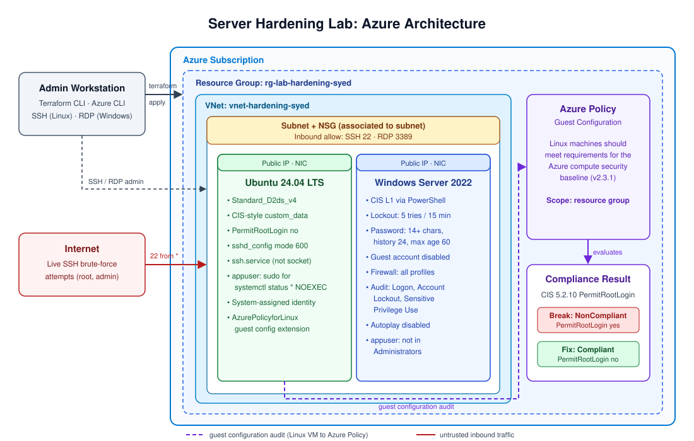

# Server-Hardening-Project

Deploy one Linux VM and one Windows Azure VM with Terraform, apply CIS Level 1 hardening controls, and continuously verify compliance using Azure Policy Guest Configuration. The project also creates least-privilege users on both systems and validates that the security restrictions are enforced.



### Link to Loom

https://loom.com/share/9f78a8765dcb48ba85eff797bf80b776

### Key Steps

&nbsp;

**1. Define the hardening scope and lab objectives** [0:00](https://loom.com/share/9f78a8765dcb48ba85eff797bf80b776?t=0)


- Harden server systems using a CIS baseline.
- Scope the work to two virtual machines:
  - One Linux VM (Ubuntu 24.04 LTS)
  - One Windows VM (Windows Server 2022)
- Use CIS Level 1 controls as the baseline for enterprise-style security enforcement.
- Validate both the configuration hardening and ongoing compliance monitoring.

&nbsp;

**2. Deploy the virtual machines and prepare the infrastructure code** [0:10](https://loom.com/share/9f78a8765dcb48ba85eff797bf80b776?t=10)


- Terraform deploys everything into `rg-lab-hardening-syed`:
  - Resource group, virtual network (`vnet-hardening-syed`) and subnet
  - Network security group allowing SSH (22) and RDP (3389), **associated to the subnet**
  - Ubuntu 24.04 LTS VM with CIS hardening passed in through `custom_data`
  - Windows Server 2022 VM with a short `computer_name` (Windows hostnames max out at 15 characters)
  - Public IPs and NICs for both VMs
- Terraform files:
  - `main.tf`: all Azure resources
  - `variables.tf`: `yourname`, `location`, `admin_username`, `admin_password` (marked `sensitive`)
  - `terraform.tfvars`: real values, blocked by `.gitignore` and never committed

```bash
terraform init
terraform plan
terraform apply
```

&nbsp;

**3. Apply Linux hardening controls** [0:30](https://loom.com/share/9f78a8765dcb48ba85eff797bf80b776?t=30)


- The Linux VM is hardened on first boot through `custom_data`:
  - Disable unused filesystems (cramfs, freevxfs)
  - Disable unused services (avahi-daemon, cups)
  - Install and enable `auditd`
  - SSH lockdown: `PermitRootLogin no`, client alive timeout
  - Password complexity via PAM `pwquality` (minimum 14 characters, upper, lower, digit and symbol required)
  - Account lockout via `pam_faillock` (5 attempts, 15-minute unlock)
  - UFW firewall: deny incoming by default, allow 22/tcp
- Because the hardening lives in the Terraform code, every new VM gets the same baseline.

&nbsp;

**4. Verify Linux compliance settings** [1:33](https://loom.com/share/9f78a8765dcb48ba85eff797bf80b776?t=93)


```bash
systemctl status auditd                     # active (running)
grep PermitRootLogin /etc/ssh/sshd_config   # PermitRootLogin no
sudo ufw status                             # Status: active, 22 allowed
sudo modprobe cramfs 2>&1                   # could not insert 'cramfs'
cat /var/log/hardening.log                  # Hardening complete
grep minlen /etc/security/pwquality.conf    # minlen=14
```

- Review open ports to confirm only approved services are exposed.

&nbsp;

**5. Simulate configuration drift on Linux** [2:24](https://loom.com/share/9f78a8765dcb48ba85eff797bf80b776?t=144)


- Deliberately break the SSH hardening control to simulate drift:

```bash
sudo sed -i 's/PermitRootLogin no/PermitRootLogin yes/' /etc/ssh/sshd_config
sudo systemctl restart ssh        # on Ubuntu the service is "ssh", not "sshd"
grep PermitRootLogin /etc/ssh/sshd_config   # PermitRootLogin yes (non-compliant)
```

- Document the drift event so it can be remediated and reported.

&nbsp;

**6. Apply Azure Policy and Guest Configuration for Linux compliance monitoring** [3:04](https://loom.com/share/9f78a8765dcb48ba85eff797bf80b776?t=184)


- Guest Configuration can only audit inside the OS when two prerequisites are in place. The lab guide didn't mention either one:
  - A **system-assigned managed identity** on the VM
  - The **AzurePolicyforLinux** extension (`Microsoft.GuestConfiguration` / `ConfigurationForLinux`)
- Assign the built-in policy **"Linux machines should meet requirements for the Azure compute security baseline"** (v2.3.1) to the resource group. The guide's search term ("Linux security baseline") returns nothing; searching **"security baseline"** finds it.
- **Drift detected:** CIS 5.2.10 "Ensure that the SSH PermitRootLogin is configured" reports **NonCompliant**, with `permitrootlogin` set to `yes`.


- **Remediate:**

```bash
sudo sed -i 's/^PermitRootLogin.*/PermitRootLogin no/' /etc/ssh/sshd_config
sudo chmod 600 /etc/ssh/sshd_config
sudo systemctl restart ssh
```

- Rescan. CIS 5.2.10 returns to **Compliant**.


&nbsp;

**7. Harden the Windows VM with security policies** [3:24](https://loom.com/share/9f78a8765dcb48ba85eff797bf80b776?t=204)


RDP into the Windows VM and run PowerShell as Administrator:

```powershell
# CIS 1.1 - Account lockout: 5 failed attempts, 15-minute lockout
net accounts /lockoutthreshold:5 /lockoutduration:15 /lockoutwindow:15

# CIS 1.2 - Password policy
net accounts /minpwlen:14 /maxpwage:60 /minpwage:1 /uniquepw:24

# CIS 2.3 - Disable the Guest account
net user Guest /active:no

# CIS 5.1 - Windows Firewall on all profiles
Set-NetFirewallProfile -Profile Domain,Public,Private -Enabled True

# CIS 9.1 - Audit logging
AuditPol /set /subcategory:"Logon" /success:enable /failure:enable
AuditPol /set /subcategory:"Account Lockout" /success:enable /failure:enable
AuditPol /set /subcategory:"Sensitive Privilege Use" /success:enable /failure:enable

# CIS 18.3 - Disable autoplay
$path = "HKLM:\SOFTWARE\Microsoft\Windows\CurrentVersion\Policies\Explorer"
if (-not (Test-Path $path)) { New-Item -Path $path -Force | Out-Null }
Set-ItemProperty -Path $path -Name "NoDriveTypeAutoRun" -Value 255 -Type DWord
```

&nbsp;

**8. Validate Windows security policy enforcement** [4:10](https://loom.com/share/9f78a8765dcb48ba85eff797bf80b776?t=250)


```powershell
net accounts                                        # lockout and password policy
net user Guest | Select-String "Account active"     # No
Get-NetFirewallProfile | Select-Object Name, Enabled
AuditPol /get /category:"Logon/Logoff"
AuditPol /get /category:"Privilege Use"
Get-ItemProperty -Path $path -Name NoDriveTypeAutoRun   # 255
```

- Confirm each value matches the required thresholds.

&nbsp;

**9. Create a least-privilege Windows user** [4:40](https://loom.com/share/9f78a8765dcb48ba85eff797bf80b776?t=280)


- Create `appuser` with a password that meets the new policy. The password must not contain any part of the account's display name (see Troubleshooting).
- Add it to the standard Users group only.

```powershell
$password = Read-Host -AsSecureString "Password for appuser"
New-LocalUser -Name "appuser" -Password $password -FullName "appsyed"
Add-LocalGroupMember -Group "Users" -Member "appuser"
Get-LocalGroupMember -Group "Administrators"
```

- Result: the Administrators group contains only `labadmin`.


&nbsp;

**10. Create a least-privilege Linux user** [5:35](https://loom.com/share/9f78a8765dcb48ba85eff797bf80b776?t=335)


- Create `appuser` and set a compliant password:

```bash
sudo useradd -r -s /bin/bash -m appuser
sudo passwd appuser
```

- Note: the guide describes this as "no home directory, no login shell", but `-m -s /bin/bash` creates both.
- Grant sudo only for what the account needs, not full sudo.
- **Before:** the guide's rule (`/usr/bin/systemctl status, /usr/bin/journalctl`) lists `systemctl status` with no argument wildcard, so it only matches the bare command. `sudo systemctl status ssh` was denied, along with `apt-get`.


- **Fix:** allow `systemctl status *` and add `NOEXEC`. Both `systemctl status` and `journalctl` open the `less` pager as root, and without `NOEXEC` a user can type `!sh` in the pager to get a root shell.

```bash
echo 'appuser ALL=(root) NOPASSWD: NOEXEC: /usr/bin/systemctl status *' | sudo tee /etc/sudoers.d/appuser
sudo chmod 440 /etc/sudoers.d/appuser
sudo visudo -cf /etc/sudoers.d/appuser
```

&nbsp;

**11. Test restricted access and confirm compliance outcomes** [6:18](https://loom.com/share/9f78a8765dcb48ba85eff797bf80b776?t=378)

- Switch to `appuser`, then run each test command one at a time:

```bash
su - appuser
sudo systemctl status ssh     # allowed
sudo apt-get install vim      # denied
```

- `sudo systemctl status ssh` works without a password, and the "Failed to execute 'less'... Permission denied" message shows the pager escape is blocked. `apt-get install` is denied.


- The Windows `appuser` stays limited to non-administrative access.
- Tear down the environment when finished (all 12 resources removed):

```bash
terraform destroy
```

### Troubleshooting Log

| # | Problem | Cause | Fix |
|---|---------|-------|-----|
| 1 | `terraform init` failed with "Argument definition required" | The guide's code had several arguments on one line | Reformatted the file so each argument and nested block is on its own line |
| 2 | NSG rules had no effect | The NSG was never associated with anything, and Standard public IPs block inbound traffic by default | Added `azurerm_subnet_network_security_group_association` |
| 3 | Windows VM name too long | Windows hostnames max out at 15 characters | Added a short `computer_name` |
| 4 | `variables.tf` was empty | The guide never declared the variables | Declared `yourname`, `location`, `admin_username`, `admin_password` (sensitive) |
| 5 | `SkuNotAvailable` on apply for both VMs | `Standard_B1s` had no capacity in the region | Checked available sizes with `az vm list-skus`; skipped ARM sizes (a "p" in the name) for x64 images |
| 6 | Size name rejected | Missing prefix: `D2ds_v4` | Used `Standard_D2ds_v4` |
| 7 | Ubuntu image | The guide used 22.04 (`0001-com-ubuntu-server-jammy` / `22_04-lts-gen2`) | Switched to 24.04 (`ubuntu-24_04-lts` / `server`) |
| 8 | `Unit sshd.service not found` | On Ubuntu the service is `ssh`, not `sshd` | `sudo systemctl restart ssh` |
| 9 | Portal changes vs. Terraform | Manual portal changes are drift; state is a record, not a lock, and drift only reverts on the next apply | Added the `identity` block to Terraform after enabling it in the portal, so apply wouldn't remove it |
| 10 | Policy not found in search | The guide's search term didn't match | Searched "security baseline" |
| 11 | Guest Configuration couldn't audit the VM | Missing prerequisites | Added a system-assigned managed identity and the AzurePolicyforLinux extension |
| 12 | Terraform error after adding the extension | The extension resource was pasted inside the VM block | Closed the VM block first, then defined the extension as its own resource |
| 13 | `409 Conflict: Cannot modify extensions in the VM when the VM is not running` | The VM was stopped | `az vm start`, then `terraform apply` again |
| 14 | Every SSH rule skipped: "sshd is not present or active, nothing to audit" | Ubuntu 24.04 runs SSH through `ssh.socket`, so the audit didn't see an active SSH service | Disabled `ssh.socket`, enabled `ssh.service`, killed a leftover `sshd` listener holding port 22, then rescanned; the break was detected |
| 15 | `AuditPol` error `0x00000057` for `'Privilege Use'` | "Privilege Use" is a category, not a subcategory | Used `/subcategory:"Sensitive Privilege Use"` |
| 16 | `Set-ItemProperty` couldn't find the autoplay registry path | The guide's path had lost its backslashes (`HKLM:SOFTWAREMicrosoft...`) | Used `HKLM:\SOFTWARE\Microsoft\Windows\CurrentVersion\Policies\Explorer`, created the key with `New-Item -Force`, set `NoDriveTypeAutoRun = 255` as a DWord |
| 17 | `New-LocalUser` rejected the guide's password | Windows complexity rules reject passwords containing part of the display name ("User" from "App Service User") | Created `appuser` with display name `appsyed` |
| 18 | `sudo systemctl status ssh` denied for `appuser` | The guide's rule listed the command without arguments, so it only matched the bare command | Changed the rule to `systemctl status *` with `NOEXEC`, set the file to 440, checked syntax with `visudo -cf` |
| 19 | Test commands disappeared after `su - appuser` | Pasting `su` together with the next commands sent them to the password prompt | Ran the commands one at a time |
| 20 | Guide says "no home directory, no login shell" | `useradd -m -s /bin/bash` creates both | Noted the mismatch between the comment and the command |

**Main lesson:** Terraform describes what you want, Azure decides what you can have.

### Additional Findings from the Baseline Scan

The policy also flagged gaps in the guide's own Linux hardening script:

- `sshd_config` permissions were 644; the baseline expects 600 (CIS 5.2.1)
- `su` was not restricted via `pam_wheel` with `use_uid` (CIS 5.5)
- `ClientAliveCountMax` was 0; the baseline expects 3
- The `Protocol 2` line was never written (CIS 5.2.4). The script's `sed` only replaces an existing `#Protocol` line, and Ubuntu's default config doesn't have one.
- Default ciphers, no Allow/Deny users or groups, and no SSH banner

The SSH logs also showed live internet brute-force attempts against `root` and `admin` from multiple IPs, because the NSG allowed SSH from any source (`*`). `PermitRootLogin no` blocks the root attempts; restricting the NSG source to your own public IP is the stronger fix.

### Cautionary Notes

- Do not use weak or noncompliant credentials when creating test users.
- Do not leave SSH or RDP open to `*` in the NSG. Bots found this lab's VMs within its lifetime.
- Avoid changing settings outside the defined policy process unless you are intentionally simulating drift, and make any portal changes in Terraform too.
- If you simulate drift, document it clearly so it can be remediated and audited later.
- Be careful with Linux sudo rules: never grant full sudo unless required, and add `NOEXEC` to any command that opens a pager or editor.
- Always run `visudo -cf` on a sudoers file before relying on it. A syntax error can lock you out of sudo.
- Target Azure Policy and Guest Configuration assignments to the correct scope.
- Never commit `terraform.tfvars` or `*.tfstate` files.

### Tips for Efficiency

- Use Terraform to standardize deployment and reduce manual configuration errors.
- Run `az vm list-skus` to check VM size availability in your region before `terraform apply`.
- Keep Linux and Windows hardening steps separate so verification is easier.
- Save screenshots or logs of compliance checks as audit evidence.
- Validate each control right after applying it instead of waiting until the end.
- Copy commands from a plain-text source. Formatted documents can strip backslashes and line breaks.
- Run `AuditPol /list /subcategory:*` to get exact subcategory names before setting audit policy.
- Run `terraform destroy` when you're done to avoid paying for idle VMs.

### Repository Structure

```
.
├── main.tf                  # All Azure resources and outputs (VM public IPs)
├── variables.tf             # Input variable declarations
├── terraform.tfvars.example # Template: copy to terraform.tfvars and fill in
├── .terraform.lock.hcl      # Provider version lock
├── .gitignore               # Blocks tfvars, state and .terraform/
└── images/                  # Architecture diagram and evidence screenshots
```
